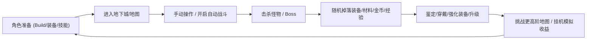
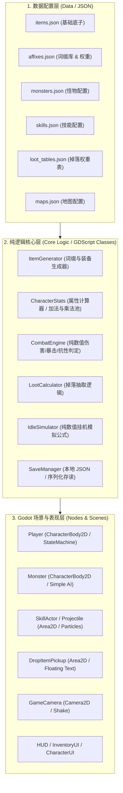

# 像素风 ARPG 打宝挂机游戏 — 完整技术设计与分阶段规划方案

> **项目角色**：主程 / 技术负责人 (Lead Programmer & Tech Lead)  
> **目标引擎**：Godot 4.x (GDScript)  
> **设计基调**：单机优先、数据驱动 (JSON)、纯粹可玩 MVP、无后端/无过度设计、渐进式迭代交付

---

## 一、 项目目标与核心闭环

本项目是一款单机优先的 **2D 像素风打宝 + 挂机 ARPG**。核心灵感汲取自经典的 PoE / 暗黑式刷宝体验（词缀随机组合、Build 成长、爆装备的快感），但所有美术、数值、系统命名与世界观均为原创，杜绝任何侵权素材。



---

## 二、 系统架构设计（解耦与数据驱动）

为了遵守“**避免 God Object、避免过度设计、逻辑与表现解耦、数据驱动**”的原则，游戏整体分层架构如下：



### 核心解耦原则：
1. **纯逻辑可独立测试**：如伤害计算 `DamageCalculator.calculate(attacker_stats, defender_stats, skill_data)`、装备生成 `ItemGenerator.generate_item(base_id, item_level, rarity)` 都是纯 GDScript Object/静态函数，不强依赖场景树 Node。
2. **表现层只负责交互与渲染**：`Player.gd` 只负责输入捕获、状态机驱动、动画播放与将逻辑层 `CharacterData` 反映到画面上。
3. **数据全部走 JSON 配置**：新增一件装备、词缀、技能或怪物，无需修改代码，只需在 `res://data/` 下添加或修改 JSON 文件。

---

## 三、 目录结构规范

```text
res://
├── doc/                        # 项目文档与技术规划
│   └── project_plan.md
├── assets/                     # 美术与音频资源 (像素占位图 & 正式资源)
│   ├── sprites/
│   │   ├── player/
│   │   ├── monsters/
│   │   ├── items/
│   │   └── environment/
│   ├── fonts/
│   └── ui/
├── data/                       # 核心 JSON 配置文件
│   ├── items/                  # base_items.json
│   ├── affixes/                # affixes.json, affix_pools.json
│   ├── monsters/               # monsters.json, bosses.json
│   ├── skills/                 # skills.json
│   ├── maps/                   # maps.json
│   └── loot_tables/            # loot_tables.json
├── scripts/                    # GDScript 脚本库
│   ├── core/                   # 游戏管理器、全局事件总线、数据加载器
│   │   ├── game_manager.gd
│   │   ├── event_bus.gd
│   │   └── data_loader.gd
│   ├── stats/                  # 属性系统 (生命/攻击/抗性/暴击等)
│   │   ├── stat_types.gd
│   │   └── character_stats.gd
│   ├── combat/                 # 战斗与伤害计算
│   │   ├── damage_info.gd
│   │   └── combat_calculator.gd
│   ├── item/                   # 装备与物品逻辑
│   │   ├── item_data.gd
│   │   ├── item_generator.gd
│   │   └── inventory_manager.gd
│   ├── skill/                  # 技能系统
│   │   ├── skill_data.gd
│   │   └── skill_controller.gd
│   ├── monster/                # 怪物 AI 与控制器
│   │   └── monster_controller.gd
│   ├── loot/                   # 掉落管理
│   │   └── loot_manager.gd
│   ├── idle/                   # 离线/后台挂机模拟器
│   │   └── idle_simulation.gd
│   └── save/                   # 存档管理
│       └── save_manager.gd
├── scenes/                     # 场景文件 (.tscn)
│   ├── main/                   # 主入口场景
│   │   ├── main.tscn
│   │   └── main.gd
│   ├── player/                 # 玩家角色场景
│   ├── monster/                # 怪物与Boss场景
│   ├── map/                    # 战斗关卡与城镇地图
│   ├── combat/                 # 投射物、受击特效、飘字
│   └── ui/                     # HUD、背包栏、人物属性面板、挂机结算面板
└── project.godot               # Godot 4 配置文件
```

---

## 四、 核心系统详细设计

### 1. 装备与词缀生成系统 (Item & Affix System)
- **装备部位**：`Weapon` (武器), `Helmet` (头盔), `Chest` (胸甲), `Gloves` (手套), `Boots` (鞋子), `Amulet` (项链), `Ring` (戒指)。
- **稀有度分级**：
  - `Normal` (白色, 0 词缀)
  - `Magic` (蓝色, 1~2 词缀)
  - `Rare` (黄色, 3~4 词缀)
  - `Legendary` (暗金/橙色, 专属固定词条 + 随机特效)
- **第一阶段核心词缀库**：
  - 基础生存：`max_hp`, `armor`, `evasion`
  - 基础输出：`attack_damage`, `attack_speed`, `crit_rate`, `crit_damage`
  - 元素输出：`fire_damage`, `cold_damage`, `lightning_damage`
- **生成流水线**：
  ```
  BaseItem (选定底模与基础白字) 
  → 决定 Rarity 
  → 按部位/等级过滤 AffixPool 
  → 随机 Roll 词缀前缀/后缀与数值区间 
  → 组装成 ItemInstance
  ```

### 2. 战斗与伤害计算系统 (Combat & Damage)
- **伤害信息包 (`DamageInfo`)**：携带物理伤害、火/冰/电元素伤害、是否暴击、来源者、击退向量等。
- **计算流水线**：
  1. 判定攻击命中 / 闪避（基于攻方命中率 vs 守方 `evasion`）
  2. 判定暴击（基于攻方 `crit_rate`，暴击时应用 `crit_damage`）
  3. 计算减伤（物理伤害受 `armor` 减免，元素伤害受对应元素抗性减免）
  4. 扣除生命值，触发受击效果与飘字。
  5. 若生命值 $\le 0$，触发死亡事件与掉落生成。

### 3. 自动战斗与 AI (Auto-Combat)
- **状态机**：`IDLE` → `SEARCH_TARGET` → `CHASE` → `IN_RANGE` → `CAST_SKILL / ATTACK` → `TARGET_DEAD` → `SEARCH_TARGET`
- **目标检索**：基于距离与权重的就近搜索，规避障碍。

### 4. 挂机模拟系统 (Idle Simulation)
- 无需后台真机跑几小时，采用纯数学统计模型模拟：
  $$\text{Kills} = \frac{\text{Duration}}{\text{Average Kill Time per Monster} + \text{Search Time}}$$
- 输入：玩家当前属性（DPS、EHP）、地图怪物平均属性、挂机时长。
- 输出：击杀数、获得经验、金币汇总、掉落装备批量 Roll 点、死亡次数折算。

---

## 五、 12 阶段渐进开发路线图 (12-Phase Roadmap)

| 阶段 | 阶段名称 | 核心交付物 | 验证标准 |
| :--- | :--- | :--- | :--- |
| **Phase 1** | **项目初始化 + 基础场景** | 项目工程配置、目录搭建、全局管理器、测试主场景与分辨率配置 | Godot 可直接运行，屏幕显示调试信息与网格地面 |
| **Phase 2** | **玩家移动 + 摄像机** | 8 方向/4 方向像素角色移动、移动平滑、相机跟随和平滑限位 | 玩家可用 WASD 移动角色，相机跟随，手感顺畅 |
| **Phase 3** | **怪物 + 基础 AI** | 基础小怪场景、巡逻/索敌/追逐玩家状态机 | 生成 2 种测试怪物，能够发现玩家并追踪至攻击范围 |
| **Phase 4** | **战斗 + 伤害系统** | 普攻判定、Hitbox/Hurtbox、伤害飘字、血条显示、怪物受击与死亡 | 玩家可近战/远程打击怪物，怪物扣血、飘字、死亡消失 |
| **Phase 5** | **技能系统** | 技能配置 (JSON)、技能冷却、技能释放 (AOE/投射物/位移) | 至少 3 个技能（如火球术、旋风斩、闪烁），支持快捷键释放 |
| **Phase 6** | **装备 + 属性系统** | 装备数据结构、词缀生成器、角色面板、穿脱装备实时计算属性 | 动态生成随机词缀装备，穿上后角色攻击/血量即时变化 |
| **Phase 7** | **掉落 + 背包系统** | 怪物死亡掉落地上光柱道具、按 E 拾取、网格背包、查看装备 Tooltip | 怪物死后爆出不同颜色光柱，拾取进入背包并可预览属性 |
| **Phase 8** | **经验 + 等级 + 成长** | 击杀经验、升级系统、属性点/基础成长、金币获取 | 升级有特效与数值提升，击杀怪物爆金币 |
| **Phase 9** | **自动战斗** | 挂机 AI 开关、自动寻怪、自动走位、自动按优先级施法 | 按 Tab/开关一键进入自动战斗，角色全自动清图 |
| **Phase 10** | **挂机模拟系统** | `IdleSimulation` 算法、挂机时长选择界面、一键结算收益报告 | 选择地图与挂机时间，瞬间计算出离线击杀、经验和掉落 |
| **Phase 11** | **本地存档系统** | `SaveManager`、JSON 序列化与反序列化、自动保存与读档恢复 | 退出游戏重新打开后，背包、装备、等级、金币完整保留 |
| **Phase 12** | **UI 与游戏体验优化** | 像素风 HUD、血球/蓝球、设置菜单、音效插槽、打击感优化 | 完整的像素 UI 包装，第一阶段 MVP 闭环体验流畅 |

---

## 六、 Phase 1 实施方案 (当前阶段)

### 目标：
搭建标准 Godot 4.x 项目结构与最小可运行主场景，确保工程环境 100% 正确配置。

### 具体变更清单：
1. **`project.godot`**：
   - 项目名称：`Pixel ARPG Loot`
   - 渲染器：`gl_compatibility`
   - 视口尺寸：`640x360`（基准像素分辨率），窗口放大缩放 `canvas_items` + `keep`
   - 像素纹理过滤设置：`textures/canvas_textures/default_texture_filter = 0` (Nearest，确保像素不模糊)
   - 主场景配置：`application/run/main_scene="res://scenes/main/main.tscn"`
2. **基础目录结构创建**：建立 `assets/`, `data/`, `scenes/`, `scripts/`, `doc/` 等目录。
3. **`scripts/core/game_manager.gd`**：全局游戏管理器骨架与事件总线。
4. **`scenes/main/main.tscn` & `scenes/main/main.gd`**：包含调试网格、基本控制台与版本信息的基础主场景。
