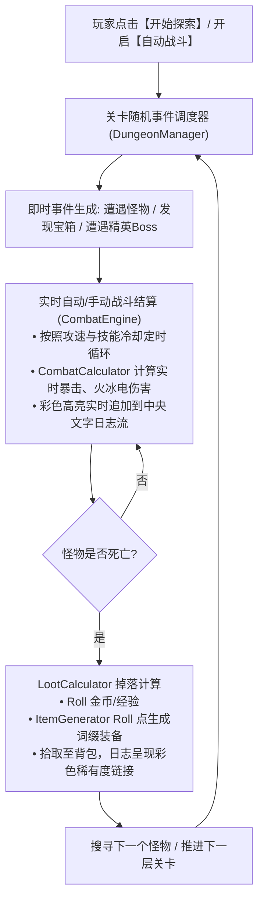

# 文字版打宝挂机 ARPG (Text-Based Idle ARPG) 技术方案

## 一、 为什么文字版极为适合打宝挂机 ARPG？
1. **聚焦核心乐趣**：打宝游戏最核心的快感在于**“词缀 Roll 点组合、Build 数值质变、爆装备掉落与挂机收益”**。文字版可以将所有视觉空间留给高密度的属性面板、装备 Tooltip 与战斗信息流。
2. **极速迭代与纯净逻辑**：彻底摆脱 2D 物理碰撞卡墙角、寻路避障等繁琐表现层问题。
3. **架构无缝复用**：因为前 5 个阶段我们严格遵守了**“纯逻辑与 Node 表现解耦”**的原则，已实现的 `CombatCalculator`（伤害计算）、`DamageInfo`、`DataLoader`（JSON配置）、`EventBus` 以及后续的 `ItemGenerator`（装备词缀生成）**100% 直接复用**，仅需重构 UI 表现层！

---

## 二、 文字版核心界面布局设计 (Text UI Layout)

基准分辨率依然保持 `640x360`（或自适应扩展 `800x450` / `1280x720`），采用三栏经典暗黑 MUD 布局：

```text
+-----------------------------------------------------------------------------------------------+
|                               像素暗黑：文字打宝挂机 ARPG                                       |
+------------------------------------+------------------------------------+---------------------+
| 【左栏：角色与装备 Build】            | 【中栏：实时战斗与探险事件流】          | 【右栏：地图/操作/挂机】|
|                                    |                                    |                     |
| 角色: 狂战士 Lv.10                  | [16:45] 进入【幽暗地牢 (第3层)】...  | [选择地图]           |
| HP:  ████████████ 350/350          | [16:45] 遭遇【狂暴骷髅战士 Lv.8】!   | > 幽暗密林 (Lv.1~5)  |
| MP:  ████████     120/120          | [16:45] 玩家释放【爆裂火球】!       | > 亡者墓穴 (Lv.6~10) |
| EXP: ██████       65%              |   -> 暴击! 造成 215 点火焰伤害!      | > 熔岩深渊 (Lv.11~15)|
|                                    | [16:46] 骷髅战士反击, 受到 24点伤害   |                     |
| [装备栏 7部位]                     | [16:46] 玩家普攻连击, 击杀目标!     | [探险控制]           |
| 武器: [暗金] 灭世巨剑 +15          |   -> 获得 经验 +45, 金币 +18         | [ 开始探索 / 自动战斗]|
| 头盔: [稀有] 磐石重盔 (3词缀)      |   -> 【大爆!】掉落:                  | [ 回城休整 / 快速整理]|
| 胸甲: [魔法] 坚韧皮甲              |      [稀有] 淬毒之刺客护手           | [ 离线挂机模拟收益 ]  |
| 手套: [稀有] 狂怒手甲              |      [金币] 50 枚                    |                     |
| 鞋子: [稀有] 疾风短靴              | [16:47] 正在搜寻下一个目标...       | [背包容量: 18/30]   |
| 项链: [暗金] 屠戮之心              |                                    | [打开完整背包栏]     |
| 戒指: [稀有] 贪婪之戒              |                                    | [打开属性详细面板]   |
+------------------------------------+------------------------------------+---------------------+
| 底部状态栏: 实时 DPS: 340 | 累计击杀: 128 只 | 累计金币: 2,450 | 自动战斗中...               |
+-----------------------------------------------------------------------------------------------+
```

---

## 三、 文字版战斗与打宝流水线


